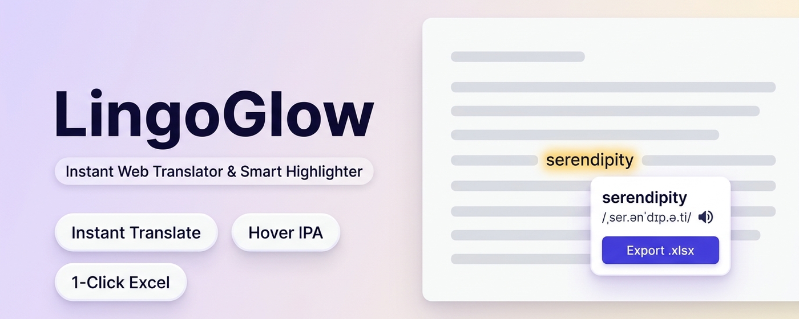

<div align="center">
  
  <h1>LingoGlow — Instant Web Translator &amp; Smart Vocab Highlighter</h1>
  <p>
    <strong>Read any webpage effortlessly. Highlight words that stick. Export your vocabulary to Excel in one click.</strong>
  </p>
  <p>
    <a href="#install-in-seconds">Install for Chrome / Edge / Brave</a> •
    <a href="#firefox--safari">Firefox &amp; Safari</a> •
    <a href="#why-lingoglow">Features</a> •
    <a href="#privacy-first-by-design">Privacy</a>
  </p>
  <br />
  
</div>

---

## Stop Breaking Your Reading Flow

Looking up unfamiliar words usually means copying text, opening a new tab, losing your place, and forgetting the word ten minutes later.

**LingoGlow** turns every webpage into an interactive language-learning canvas:

1. **Select any word or phrase** — A tactile floating card translates it instantly—no tab switching.
2. **Watch it glow on the page** — Your word is automatically highlighted across every occurrence on that page (and stays glowing whenever you revisit the URL).
3. **Hover anytime for meaning + IPA** — Rest your cursor over any highlighted word to see its translation, **IPA phonetic transcription**, and listen to native pronunciation.
4. **Export to Excel (`.xlsx`) in 1 click** — Download clean study decks from the Side Panel or Popup for Anki, Quizlet, or spreadsheet review.

---

## Why LingoGlow?

- **Instant Out-of-the-Box Translation** — Works immediately with zero sign-up or API setup using Google Translate + Free Dictionary IPA enrichment.
- **Bring Your Own AI Key (Optional)** — Prefer context-aware AI translations? Plug in your own **Gemini**, **OpenAI**, or **DeepL** key anytime in Settings.
- **Non-Destructive Smart Highlights** — Powered by the native browser Custom Highlight API (`CSS.highlights`), LingoGlow never mutates website layouts or breaks React/Vue/Next.js apps.
- **Hover Meaning + IPA + Audio** — Every saved word remembers its meaning and IPA phonetics, with instant Web Speech pronunciation (`🔊`).
- **URL-Grouped Side Panel Word Bank** — Click the toolbar icon to review **This Page** vs. **All Pages** vocabulary, search, edit meanings inline, or jump (`🎯`) straight to a highlighted word.
- **1-Click Excel (`.xlsx`) Export** — Exports a clean, ready-to-study `.xlsx` workbook (`Source Text` & `Translated Meaning`) for the current article or your entire library.
- **Soft Pastel & Dark Claymorphism UI** — Hand-crafted 3D clay surfaces, 4 highlight colors (`Sunny Yellow`, `Mint Emerald`, `Sky Blue`, `Coral Rose`), and light/dark/system themes.

---

## Install in Seconds

### Chrome / Edge / Brave (Load Unpacked)

1. Install dependencies and build the production bundle:
   ```bash
   npm install
   npm run build
   ```
2. Open `chrome://extensions` (or `edge://extensions` / `brave://extensions`).
3. Enable **Developer mode** (top-right toggle).
4. Click **Load unpacked** and select the generated `dist/` folder.
5. Pin **LingoGlow** to your toolbar and select any word on any webpage!

### Firefox & Safari

- **Firefox**: Open `about:debugging#/runtime/this-firefox` → **Load Temporary Add-on** → select `dist/manifest.json`.
- **Safari (macOS / iOS)**: Run `xcrun safari-web-extension-converter dist/`, build in Xcode, and enable **LingoGlow** under **Safari → Settings → Extensions**.

---

## Privacy-First by Design

- **Zero accounts, zero tracking, zero analytics servers.**
- Your saved vocabulary, page URLs, and optional API keys stay **100% on your local machine** (`chrome.storage.local` / `browser.storage.local`).
- Translations are requested directly from your chosen provider only when you select text.

---

## FAQ

**Do I need an API key to start?**  
No. LingoGlow works out of the box with free translation and IPA phonetic lookup.

**Will my highlights still be there if I refresh or come back tomorrow?**  
Yes! LingoGlow indexes saved words by normalized webpage URL and automatically re-applies your highlights across every occurrence when you revisit the page.

**What format does Export Excel produce?**  
A real OpenXML `.xlsx` workbook with `Source Text` and `Translated Meaning` columns that opens directly in Microsoft Excel, Google Sheets, and Apple Numbers.

---

## Local Development & Architecture

Preview the **Interactive Reading Simulator**, **Side Panel**, **Popup**, and **Options** side-by-side with hot reload:

```bash
npm install
npm run dev        # Interactive Dev Workbench
npm run typecheck  # Strict TypeScript check
npm run build      # Production MV3 bundle in dist/
```

<details>
<summary>Project Structure</summary>

```text
├── docs/assets/              # Marquee cover (1400x560) & small promo tile (440x280)
├── public/
│   ├── icons/                # LingoGlow extension icons (16, 32, 48, 128px)
│   └── manifest.json         # Manifest V3 configuration
├── src/
│   ├── background/           # Service worker (translation router, IPA lookup, context menu)
│   ├── content/              # Shadow DOM Claymorphism popup, CSS.highlights engine & hover tooltip
│   ├── dev/                  # Interactive Reading Simulator & live workbench
│   ├── options/              # Settings, theme, provider keys & full-library export
│   ├── popup/                # Toolbar quick-view & 1-click Excel export
│   ├── shared/               # Brand logo, storage, messaging, Claymorphism CSS & .xlsx generator
│   └── sidepanel/            # Persistent Side Panel vocabulary manager
└── vite.config.ts            # Multi-entry + IIFE content script bundler
```

</details>
