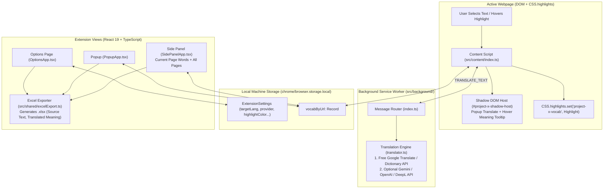

# Application Architecture & Technical Design (`architecture.md`)

- **Phase**: `INCEPTION`
- **Stage**: `Application Design`

---

## 1. High-Level System Architecture



---

## 2. Core Technical Mechanisms

### 2.1 URL Normalization (`normalizePageUrl`)
To group vocabulary reliably by webpage regardless of hash fragments or tracking query parameters:
- Strip `#hash` fragments and common tracking params (`utm_*`, `fbclid`, `gclid`), keeping `origin + pathname` (plus significant query parameters if applicable).

### 2.2 DOM-Safe Highlighting via `CSS.highlights` (`::highlight(project-x-vocab)`)
1. Inject a `<style id="project-x-highlight-style">` into `document.head`:
   ```css
   ::highlight(project-x-vocab) {
     background-color: rgba(250, 204, 21, 0.38);
     color: inherit;
     text-decoration: underline wavy #eab308;
   }
   ```
2. Walk `document.body` using `document.createTreeWalker(document.body, NodeFilter.SHOW_TEXT)` (skipping `SCRIPT`, `STYLE`, `NOSCRIPT`, `TEXTAREA`, `INPUT`, and `#project-x-shadow-host`).
3. For every saved `VocabItem` on the current URL, find all case-insensitive whole-word/phrase matches in text nodes, construct `Range` objects, and register them in `CSS.highlights.set('project-x-vocab', new Highlight(...ranges))`.
4. Store an in-memory array of `{ range: Range, item: VocabItem }[]` for fast hover hit-testing.

### 2.3 Hover Detection over `CSS.highlights` Ranges
Because `::highlight()` does not create DOM elements:
- Attach a passive `mousemove` listener throttled via `requestAnimationFrame`.
- For the cursor position `(clientX, clientY)`, iterate over active `{ range, item }` entries and check `range.getClientRects()` to see if any `DOMRect` contains `(clientX, clientY)`.
- When matched, position the Shadow DOM hover card right above/below the `DOMRect` displaying `item.sourceText` and `item.translatedText`.

### 2.4 Standalone `.xlsx` Generator (`src/shared/excelExport.ts`)
- Generates a standards-compliant OpenXML `.xlsx` (ZIP container with `[Content_Types].xml`, `_rels/.rels`, `xl/workbook.xml`, `xl/worksheets/sheet1.xml`, and `xl/styles.xml`) directly in TypeScript with zero heavy third-party dependencies, outputting:
  - Column A: **Source Text**
  - Column B: **Translated Meaning**
